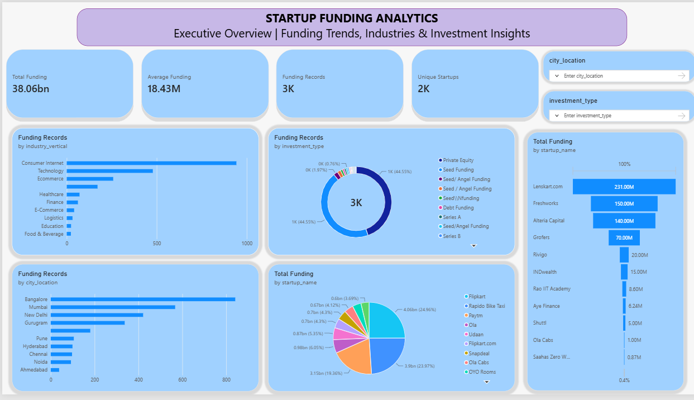

# Startup Funding Analytics

### Analyzing Startup Investments, Funding Trends, Industries, and Investment Patterns

## 📌 Project Overview

Startup Funding Analytics is a data analytics project focused on exploring and analyzing startup investment data to understand funding trends, investment patterns, industry performance, and geographical distribution.

The project uses Python for data cleaning, data preprocessing, exploratory data analysis (EDA), and visualization. Power BI is used to create an interactive dashboard that presents important funding insights through KPIs, charts, and filters.

The main objective is to transform raw startup funding data into meaningful insights that help understand the startup investment ecosystem.

## 🎯 Project Objectives

- Analyze historical startup funding trends.
- Identify industries receiving the highest investment.
- Explore startup funding distribution across different cities.
- Understand different types of investments.
- Identify startups receiving funding.
- Analyze funding amounts and investment patterns.
- Build an interactive Power BI dashboard.

## 🛠️ Technologies Used

| Technology | Purpose |
|---|---|
| Python | Data analysis and preprocessing |
| Pandas | Data cleaning and manipulation |
| NumPy | Numerical operations |
| Matplotlib | Data visualization |
| Seaborn | Statistical visualization |
| Power BI | Interactive dashboard development |
| VS Code | Development environment |
| Git & GitHub | Version control and project hosting |

## 📂 Dataset Information

The project uses a startup funding dataset containing information about startup investments.

### Dataset Overview

- Total Records: 3,044
- Total Columns: 10
- Unique Startup Names: 2,459

### Dataset Columns

| Column | Description |
|---|---|
| source_record_id | Original record identifier |
| date | Date of investment |
| startup_name | Name of the startup |
| industry_vertical | Industry category |
| sub_vertical | Specific business area |
| city_location | Startup location |
| investors_name | Name of investors |
| investment_type | Type of investment |
| amount_in_usd | Recorded investment amount |
| remarks | Additional investment information |

## ⚙️ Project Workflow

### 1. Data Understanding
- Loaded and inspected the raw dataset.
- Examined dataset dimensions and column names.
- Identified missing values and data types.
- Checked duplicate records.
- Understood the structure of the dataset.

### 2. Data Cleaning and Preprocessing
- Standardized column names.
- Handled missing values.
- Converted date columns into appropriate date formats.
- Converted funding amounts into numeric values.
- Identified invalid and inconsistent records.
- Prepared the cleaned dataset for analysis.

### 3. Exploratory Data Analysis (EDA)

Performed exploratory analysis to understand:

- Year-wise startup funding trends.
- Industry-wise funding distribution.
- City-wise startup funding activity.
- Investment type distribution.
- Funding amount distribution.
- Average and median investment amounts.

### 4. Data Visualization

Created visualizations to identify patterns and trends in startup funding.

Key visualizations include:

- Funding by Year.
- Top 10 Industries by Funding Records.
- Top 10 Cities by Funding Records.
- Funding Amount Distribution.
- Median Funding by Investment Type.
- Funding Amount Distribution Across Years.

### 5. Power BI Dashboard

Developed an interactive Power BI dashboard titled **Startup Funding Analytics**.

#### Key Performance Indicators (KPIs)

- Total Funding
- Funding Records
- Unique Startups
- Average Funding

#### Visualizations

- Funding by Year (Line Chart)
- Top 10 Industries by Funding Records
- Top 10 Cities by Funding Records
- Investment Type Distribution (Donut Chart)

#### Interactive Filters

- Year
- City
- Investment Type

## 📊 Key Insights

The initial dataset analysis revealed:

- The dataset contains 3,044 startup funding records.
- There are 2,459 unique nonblank startup names.
- Funding amounts are missing or unparseable in 979 records.
- Three records contain invalid or missing dates.
- Funding amounts have a highly uneven distribution.

Further insights can be explored through the interactive Power BI dashboard.

## 📁 Project Structure

```text
Startup Funding Analytics/
│
├── data/
│   ├── raw/
│   │   └── startup_funding.csv
│   │
│   └── processed/
│       └── startup_funding_cleaned.csv
│
├── scripts/
│   ├── 01_data_understanding.py
│   ├── 02_data_cleaning.py
│   ├── 03_exploratory_analysis.py
│   └── 04_visualizations.py
│
├── visualizations/
│   └── Generated Charts
│
├── powerbi/
│   └── Startup_Funding_Analytics.pbix
│
├── README.md
└── .gitignore
```

## 🚀 How to Run the Project

### Prerequisites

- Python 3.x
- VS Code
- Required Python libraries
- Power BI Desktop

### Step 1: Clone the Repository

```bash
git clone https://github.com/shubhamlokewar/Startup-Funding-Analytics.git
```

### Step 2: Navigate to the Project Folder

```bash
cd Startup-Funding-Analytics
```

### Step 3: Create a Virtual Environment

```bash
python -m venv .venv
```

### Step 4: Activate the Virtual Environment

For Windows PowerShell:

```powershell
.venv\Scripts\Activate.ps1
```

### Step 5: Install Required Libraries

```bash
pip install pandas numpy matplotlib seaborn
```

### Step 6: Run the Python Scripts

Run the scripts in the following order:

```bash
python scripts/data_understanding.py
python scripts/data_cleaning.py
python scripts/exploratory_analysis.py
python scripts/visualizations.py
```

### Step 7: Open Power BI Dashboard

Navigate to the `powerbi` folder and open:

`Startup_Funding_Analytics.pbix`

Open it using Power BI Desktop to explore the interactive dashboard.

## 📈 Dashboard Preview

The Power BI dashboard provides an overview of startup funding trends, industries, cities, and investment types.

<!-- Add your dashboard screenshot here -->



## 💡 Skills Demonstrated

- Data Cleaning and Preprocessing
- Exploratory Data Analysis (EDA)
- Data Manipulation using Pandas
- Statistical Analysis
- Data Visualization
- Business Intelligence
- Power BI Dashboard Development
- Data Interpretation
- Python Programming
- Git and GitHub

## 🔮 Future Improvements

- Perform deeper investor-level analysis.
- Analyze startup funding growth across industries.
- Identify top-funded startups.
- Add more interactive dashboard filters.
- Explore predictive analysis for startup funding trends.
- Automate the data cleaning and reporting workflow.

## 👨‍💻 Author

**Shubham Lokewar **

Aspiring AI Engineer and Python Developer interested in building practical applications and data-driven solutions.

---

⭐ If you find this project useful, consider giving the repository a star!
